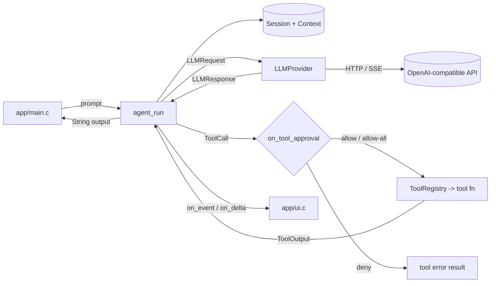

# Repository Guidelines

TinyAgent is a C17 agent runtime: a reusable static library (`tiny_agent_core`) plus a small CLI (`tiny-agent`). The library provides an agent loop, tool registry, session/context handling, an HTTP transport, and OpenAI-compatible providers (Chat Completions and Responses, with optional streaming).

## Project Overview

- **Library first.** `include/agent/**` is the public API; `app/` is one consumer and reference host.
- **Provider-agnostic core.** `src/core/agent.c` talks to any `LLMProvider`; OpenAI is one implementation. `src/llm/mock_llm.c` is a production-shipped test provider.
- **Portable core.** The library builds as C17 on POSIX and Windows. POSIX `fork`/`execvp`/`pipe`/`poll`, `/bin/sh -c`, and filesystem calls are isolated in `src/infra/platform.c`; Windows uses Win32 process, pipe, and wide-character file APIs. The CLI falls back to line mode on Windows because the full-screen backend requires ncursesw. `rg` is still required on `PATH` for `search`.
- **No install/export rules.** Consumers are expected to use `add_subdirectory` and link `TinyAgent::Core`.

## Architecture & Data Flow



**Layering, bottom-up**

1. `src/infra/` — `String` buffer helpers, `HttpClient` (libcurl), error utilities, and the `platform` layer (monotonic clock, tty detection, UTF-8 paths, files, directories, atomic publish). No upward dependencies.
2. `src/context/` — in-memory message history (`Context`) and system prompt/session (`Session`).
3. `src/llm/` — `LLMProvider` vtable (`complete`, `destory`), response destruction, mock provider.
4. `src/llm/providers/` — OpenAI request/response codecs (`openai_chat.c`, `openai_responses.c`, `openai_json.c`, `openai_stream.c`) and provider wiring (`openai.c`).
5. `src/tools/` — tool registry, argument helpers, process spawning, six built-in tools.
6. `src/core/agent.c` — orchestration only: rounds, events, approvals, retries, cancellation.

**Agent run flow**

- `agent_run` clears the error, validates arguments, appends the user message, and emits `AGENT_EVENT_RUN_START`. After `run_rounds` returns it emits `AGENT_EVENT_RUN_END` with the final status or error message. Early validation, pre-cancel, and context-append failures return before `RUN_START`, so no events fire in those cases.
- Each round: build an `LLMRequest` over the borrowed `Context` and tool definitions → `llm_provider_complete` → append a deep copy of the assistant response to `Context` → emit `AGENT_EVENT_LLM_RESPONSE`.
- `LLM_FINISH_STOP` produces the final `String`; `LLM_FINISH_TOOL_CALLS` executes each call (approval → `fn` → `TOOL_RESULT` → append `TOOL_MESSAGE`); `LENGTH`/`FILTERED`/`REFUSED`/`UNKNOWN` map to `AgentStatus` failures.
- `max_round` (default 40) caps provider calls. Consecutive failed tool rounds are capped by `max_tool_retries` (default 3, zero selects the default) and abort with `AGENT_ERR_TOOL_RETRIES`.
- Callbacks (`on_event`, `on_delta`, `on_tool_approval`, `is_cancelled`) are invoked synchronously on the caller's thread. There are no worker threads; blocking happens in curl and tool subprocesses.
- Streaming is advisory: deltas go through `on_delta`, but the provider still returns a fully assembled `LLMResponse`.

**Ownership**

- Plain `malloc`/`calloc`/`realloc`/`free`; no arena or custom allocator.
- Configuration strings are copied at init. `Agent` borrows its `AgentConfig`, provider, and registry; `LLMRequest` borrows the context and tool array.
- Providers allocate `LLMResponse` and all of its strings; callers release them with `llm_response_destroy`.
- `ToolExecutionFn` transfers ownership of `ToolOutput` and `content` to the caller on both success and non-OK returns.
- `String` must be initialized before use and released with `string_destroy`.

## Key Directories

| Path | Purpose |
|---|---|
| `src/core/` | Agent loop, event emission, tool dispatch, approval/retry/cancel policy. |
| `src/llm/` | Provider abstraction, mock provider, response lifecycle. |
| `src/llm/providers/` | OpenAI Chat Completions + Responses codecs, SSE streaming, JSON helpers. |
| `src/tools/` | Registry, shared argument/JSON/process helpers, `run_command`. |
| `src/tools/file_system/` | `list_dir`, `read_file`, `search`, `write_file`, `edit_file`. |
| `src/infra/` | `String`, HTTP client, error helpers, POSIX/Windows platform layer. |
| `src/context/` | Conversation history and session state. |
| `src/memory/` | Empty placeholder; not referenced by CMake. |
| `include/agent/` | Public headers. Internal-only headers stay in `src/` (`src/tools/internal.h`, `src/llm/providers/openai_internal.h`). |
| `app/` | CLI entry point (`main.c`), terminal UI/events/status line (`ui.c`), ncursesw full-screen backend (`tui.c`). |
| `tests/` | C unit/integration tests mapped into CTest, plus Python fake-server/CLI drivers. |
| `build/` | CMake/Ninja output; gitignored. Contains `compile_commands.json`. |

## Development Commands

```sh
# Configure (Debug matters: tests rely on assert)
cmake -S . -B build -G Ninja -DCMAKE_BUILD_TYPE=Debug
cmake --build build
ctest --test-dir build --output-on-failure

# One test / a subset
ctest --test-dir build -R '^test_agent_run$' --output-on-failure
ctest --test-dir build -R '^(test_openai_|test_cli_)' --output-on-failure
ctest --test-dir build -N          # list registered tests

# Run the CLI
export DEEPSEEK_API_KEY='...'
./build/app/tiny-agent             # interactive REPL
./build/app/tiny-agent -p 'List files here' --yes
./build/app/tiny-agent --json -p 'List files here' --yes
DEEPSEEK_TIMEOUT_MS=300000 ./build/app/tiny-agent

# Format
find src app include tests -name '*.c' -o -name '*.h' | xargs clang-format -i
```

`ctest` does not build. Test working directory is `build/tests`. Configure without `CMAKE_BUILD_TYPE` defaults to **Release** (`-O3 -DNDEBUG`), so use Debug when touching tests.

## Code Conventions & Common Patterns

**Formatting and naming**

- `.clang-format` is LLVM with `Language: C`: 2-space indent, 80-column limit, attached braces, right-aligned pointers, no tabs.
- Files and functions are `snake_case`; types are `PascalCase` (`AgentConfig`, `LLMResponse`, `ToolDefinition`); enum constants are `UPPER_SNAKE_CASE` with subsystem prefixes (`AGENT_ERR_*`, `LLM_FINISH_*`, `TOOL_DECISION_*`, `AGENT_EVENT_*`).
- Public includes use `"agent/foo.h"`; private implementation headers use quoted relative includes. Every header has an `#ifndef TINY_AGENT_<NAME>_H` guard.
- Define `_POSIX_C_SOURCE 200809L` at the top of each `.c` that needs POSIX APIs; it is not set globally.

**Error handling**

- Functions return `AgentStatus`; `AGENT_OK` is success. Use `AgentError` out-parameters plus `agent_error_set`/`agent_error_clear` and the `AGENT_ERROR(error, "...")` macro for context (message, file, function, line).
- Do not return `-1` for library errors. Do not `abort` on bad input.
- Tool execution failures may either return non-OK or return `AGENT_OK` with `ToolOutput.is_error = 1`. The content is always sent to the model so it can retry. Use `tool_fail`/`tool_json` helpers in `src/tools/internal.h`.
- Preserve existing misspelled public identifiers; they are part of the ABI/API: `openai_provider_destory`, `llm_provider_destory`, `context_destory`, `session_destory`, `tool_registry_destory`, `AGENT_ERR_INVAILD_ARGUMENT`, `MessageArrary`, and the `LLMProviderOps.destory` field.

**Tools**

- A tool is a `const ToolDefinition` defined in its `src/tools/...` translation unit, declared `extern` in the matching public header (e.g. `read_file_tool` in `include/agent/tools/file_system/read_file.h`), and paired with a `*_register(ToolRegistry *)` helper. It carries name, description, JSON Schema string, `strict`, `mutating`, and `ToolExecutionFn`.
- `mutating=1` only for `write_file`, `edit_file`, `run_command`; read-only tools must not prompt.
- Parse arguments with the `tool_string`/`tool_optional_string`/`tool_integer` helpers; reject unknown shapes early.
- `read_file`, `write_file`, and `edit_file` enforce a 1 MiB text limit; writes/edits use `tool_atomic_write`. `read_file` follows regular-file symlinks (`O_RDONLY | O_NONBLOCK`, then `fstat`) and rejects non-regular targets, embedded NULs, and invalid UTF-8. `list_dir` rejects non-UTF-8 entry names without returning a partial listing.
- `search` shells out to `rg --no-config --json --line-number --color=never`; exit 1 from ripgrep means "no matches", not failure.
- Tool processes must poll `ToolContext.is_cancelled` and clean up child processes; `run_command` uses `/bin/sh -c`.

**State and concurrency**

- No global mutable state. `approve_all` is per-`Agent` and persists for that agent's lifetime after `TOOL_DECISION_ALLOW_ALL`.
- A denied call becomes a tool error result, not a run failure.
- Cancellation is cooperative through `AgentConfig.is_cancelled`; it is polled before rounds, before tool calls, during provider requests, and by subprocess tools. Return non-zero to abort with `AGENT_ERR_CANCELLED` (14).
- A cancelled tool round must append an error result for every pending call before returning; do not discard completed results or leave unpaired calls in session history.
- Status mapping is centralized: `LLM_FINISH_STOP → AGENT_OK`, `LENGTH → AGENT_ERR_LLM_TRUNCATED`, `FILTERED → AGENT_ERR_LLM_FILTERED`, `REFUSED → AGENT_ERR_LLM_REFUSED`.

**Build integration**

- `src/CMakeLists.txt` lists sources explicitly; there are no globs. A new `.c` file is invisible until added there (undefined references otherwise).
- Every target must call `tiny_agent_enable_warnings()`; all builds use `-Wall -Wextra -Wpedantic -Werror`.
- `PkgConfig::CJSON` is directory-scoped; tests that include `<cjson/cJSON.h>` must link it explicitly.

## Important Files

| File | Role |
|---|---|
| `CMakeLists.txt` | C17 flags, warnings-as-errors, default Release, subdirectories. |
| `src/CMakeLists.txt` | Explicit library source list, public include dir, curl/cJSON dependencies. |
| `src/core/agent.c` | Agent loop, events, approvals, retries, cancellation. |
| `include/agent/agent.h` | `agent_create` / `agent_run` / `agent_destroy` / `agent_version`. |
| `include/agent/config.h` | `AgentConfig`, defaults (`max_round=40`, retries=3), approval decisions, callbacks. |
| `include/agent/event.h` | Event enum and callback contract. |
| `include/agent/llm.h` | `LLMProvider` vtable, `LLMRequest`, `LLMResponse`, finish reasons. |
| `include/agent/tool.h` | `ToolDefinition`, `ToolExecutionFn`, `ToolOutput`, registry API. |
| `src/tools/tool.c` | Registry implementation (borrows definitions, owns the array). |
| `src/tools/internal.h` | Private JSON/argument/file/process helpers and `TOOL_FILE_LIMIT`. |
| `src/llm/providers/openai.c` | Base URL normalization, endpoint joining, provider init/destroy. |
| `src/infra/http_client.c` | libcurl transport, timeouts, response ownership. |
| `app/main.c` | CLI parsing, defaults, run modes, JSON output, exit codes. |
| `app/ui.c` | Terminal facade: line-mode transcript/spinner plus full-screen delegation. |
| `app/tui.c` | ncursesw full-screen backend: layout, editor, history, scrollback, approval. |
| `tests/CMakeLists.txt` | All test registration, timeouts, Python gating. |

## Portability and strict builds

- GCC/Clang build with `-std=c17 -pedantic-errors -Wall -Wextra -Werror` plus
  `-Wstrict-prototypes -Wmissing-prototypes -Wold-style-definition -Wvla
  -Wundef -Wshadow -Wformat=2`. MSVC builds with `/std:c17 /W4 /WX /utf-8`.
- Keep platform-specific code in `src/infra/platform.c` or behind
  `#if defined(_WIN32)`. Paths and strings crossing the API are UTF-8; Windows
  converts to UTF-16 at the Win32 boundary.
- Do not introduce a public macro named `ERROR`: Windows headers define it.
  Use `AGENT_ERROR`.
- The POSIX-only tests (`test_read_file`, `test_list_dir`, `test_coding_tools`)
  and the PTY CLI tests are registered only under `if (UNIX)`.
  `test_cancellation` and `test_platform` run everywhere; the former compiles
  its `run_command` subprocess case only on POSIX. Windows runs the portable C
  tests plus the fake-server tests.

## Runtime/Tooling Preferences

- **Compiler/runtime:** C17 (`-std=c17` / `/std:c17`, no GNU extensions), GCC/Clang on POSIX, MSVC on Windows. CMake ≥ 3.16; Ninja is the generator in the existing build tree.
- **Dependencies:** libcurl (`CURL::libcurl`), cJSON (`find_package(cJSON CONFIG)`; PUBLIC because `agent/tool.h` includes it), POSIX libc on Unix, Win32 + UCRT on Windows. ncursesw (`find_package(Curses)` with `CURSES_NEED_WIDE`) is required only for the POSIX full-screen TUI. Python 3 is optional and only enables integration tests.
- **Runtime dependency:** `rg` (ripgrep) must be on `PATH` for the `search` tool.
- **Build artifacts:** `build/` is ignored and untracked; do not commit `.VSCodeCounter/`, object files, or generated libraries. `compile_commands.json` lives at `build/compile_commands.json`.
- **No install rules, no CMake presets, no sanitizer targets.** The GitHub Actions workflow (`.github/workflows/cmake-multi-platform.yml`) builds with GCC, Clang, and MSVC. Do not assume `cmake --install` works.
- **CLI vs library defaults differ:** zero-initialized `OpenAIConfig` selects Chat Completions, while the CLI defaults to Responses with `deepseek-flash`. The CLI reads `TINY_AGENT_API_KEY` first, then `DEEPSEEK_API_KEY`.
- Public `include/agent/tool.h` includes `<cjson/cJSON.h>`, so `tiny_agent_core` links cJSON `PUBLIC`; consumers using `add_subdirectory` inherit its include dirs and library.

## Testing & QA

**Framework and shape**

- No third-party test framework. Each C test is a standalone executable with `int main(void)` returning 0/1. Most use a local `CHECK(expr)` macro that prints to stderr and returns 1; `test_tool_registry.c` uses `assert`; a few older tests use explicit exit codes.
- `include/agent/mock_llm.h` + `src/llm/mock_llm.c` are part of the library. `mock_llm_init(&provider, responses, count)` deep-copies fixtures and replays them in order; exhaustion returns `AGENT_ERR_INVAILD_ARGUMENT`. Destroy with `llm_provider_destory`.
- Integration tests use Python stdlib only: `ThreadingHTTPServer` on `127.0.0.1:0` (ephemeral port), a daemon thread, and a child binary receiving the base URL as `argv[1]`. There are no fixed ports and no inter-test ordering.
- Python drivers are named `<area>_test.py` (not `test_*.py`), while C tests are `test_<area>.c` with a matching CTest name.

**Commands**

```sh
ctest --test-dir build --output-on-failure          # full suite
ctest --test-dir build -R '^test_cli_' -V           # CLI/SSE group
./build/tests/test_agent_run                        # direct execution
python3 tests/openai_server_test.py build/tests/test_openai_complete
```

**Adding tests**

1. Add `tests/test_<area>.c` (or `<area>_test.py`).
2. In `tests/CMakeLists.txt`: `add_executable`, `target_link_libraries(... PRIVATE TinyAgent::Core [PkgConfig::CJSON])`, `tiny_agent_enable_warnings(...)`, then `add_test(NAME test_<area> COMMAND ...)`; set `TIMEOUT` for anything slow.
3. Gate Python-driven tests behind `if (Python3_Interpreter_FOUND)` and pass `$<TARGET_FILE:...>`.
4. Build and run the targeted test, then the full suite.

**Pitfalls**

- `test_agent.c` is an empty placeholder that always passes; the real loop coverage is `test_agent_run.c`.
- In Release builds, `NDEBUG` removes `assert` from `test_tool_registry.c`; use Debug.
- If Python 3 is missing, the Python-driven CTest entries silently disappear — check `ctest -N` counts, not just "all tests passed".
- `test_coding_tools` hard-fails without `rg`; POSIX `/bin/sh` is required. There are no skip conditions.
- Several tests are timing-sensitive (50 ms timeout vs 200 ms server delay, cancellation assertions under 2 s). Prefer generous margins; do not add sleeps without need.
- `ctest` uses `build/tests` as the working directory; tests that `chdir` must restore or use absolute paths.
- Tests need no API key; fake servers expect `Authorization: Bearer secret` and CLI tests pass `--api-key secret`.
- Local fake-server drivers set both `NO_PROXY` and `no_proxy` for loopback hosts; preserve this isolation when adding subprocess-based integration tests.

**Coverage expectations**

- Run the full suite after behavior changes. Add or update tests for new tool behavior, status mappings, ownership/error paths, and CLI contract changes.
- Keep tests deterministic and isolated (temporary directories via `mkdtemp`/`mkstemp`, explicit cleanup).
- Provider SSE errors and interleaved Chat tool deltas are covered in `test_openai_complete.c`; CLI streaming remains covered by `cli_stream_test.py`.
